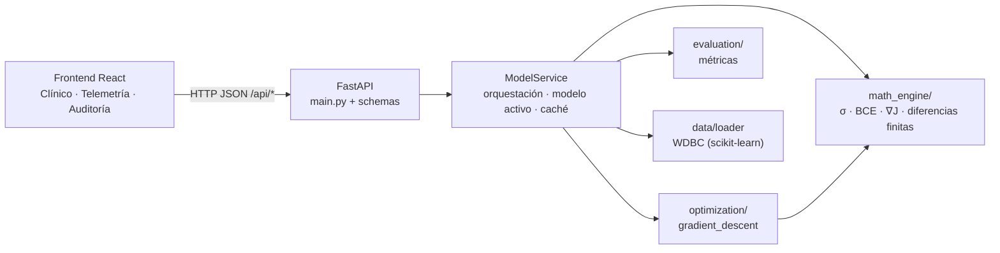
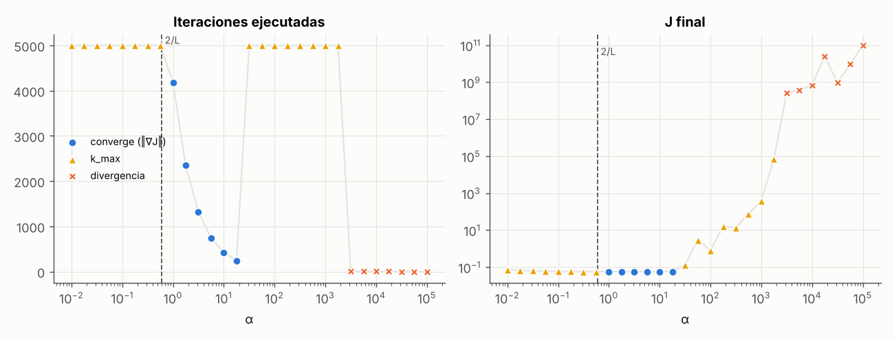
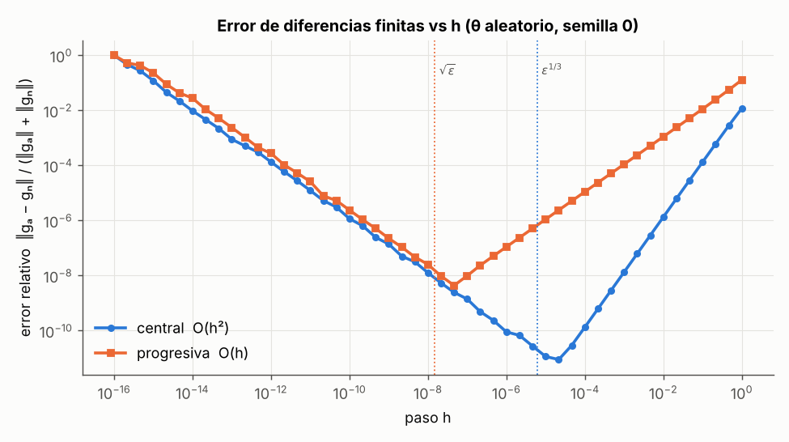

# WDBC Optimizer · Motor de optimización numérica y CDSS oncológico


[](https://github.com/maiwxzs/wdbc-optimizer/actions/workflows/ci.yml)

Plataforma web *full-stack* para el diagnóstico asistido de cáncer de mama (conjunto *Wisconsin Diagnostic Breast Cancer*) y para la **auditoría rigurosa de un optimizador**. La regresión logística no se presenta como "un modelo de *machine learning*", sino como la solución numérica de un problema de optimización convexa sin restricciones:

```math
\min_{\boldsymbol w\in\mathbb R^{30},\,b\in\mathbb R}\; J(\boldsymbol w,b)= \frac1m\sum_{i=1}^m\Big[\log\big(1+e^{z_i}\big)-y_i z_i\Big]+\frac\lambda2\lVert\boldsymbol w\rVert_2^2,\qquad z_i=\boldsymbol w^\top\boldsymbol x_i+b
```

resuelto con **gradiente descendente implementado desde cero en NumPy**, con aritmética IEEE-754 estable y verificación del gradiente por diferencias finitas.

> ⚠️ **Herramienta académica.** No es un dispositivo médico ni sustituye el criterio clínico.

Proyecto del curso **Métodos Numéricos** · Universidad de los Llanos.

---

## Tabla de contenidos

1. [Objetivo y problema](#objetivo-y-problema)
2. [Características](#características)
3. [Tecnologías](#tecnologías)
4. [Arquitectura](#arquitectura)
5. [Fundamentos matemáticos](#fundamentos-matemáticos)
6. [Estructura del repositorio](#estructura-del-repositorio)
7. [Instalación y ejecución](#instalación-y-ejecución)
8. [Ejemplo de uso](#ejemplo-de-uso)
9. [Resultados](#resultados)
10. [Pruebas](#pruebas)
11. [Documentación](#documentación)
12. [Limitaciones y trabajo futuro](#limitaciones-y-trabajo-futuro)
13. [Licencia](#licencia)
14. [Cómo citar](#cómo-citar)
15. [Equipo](#equipo)

---

## Objetivo y problema

**Objetivo general:** implementar y auditar, desde sus fundamentos matemáticos, un optimizador de gradiente descendente para la regresión logística regularizada, y demostrar empíricamente su convergencia, sus límites de estabilidad y la corrección de su gradiente.

**Problema:** no existe una fórmula cerrada para $\boldsymbol\theta^\star$, porque $\nabla J=\mathbf 0$ es un sistema no lineal. Las fórmulas de libro, además, fallan en `float64`: la sigmoide desborda, satura a $1.0$ y produce $0\cdot\log0=\texttt{NaN}$. El proyecto resuelve ambas cosas y hace visible **por qué** funciona. Más detalle en [planteamiento](docs/introduction/problem_statement.md) y [objetivos](docs/introduction/objectives.md).

## Características

- **Motor numérico en NumPy:** sigmoide estable por tramos, entropía cruzada en tres formulaciones (Log-Sum-Exp, *clip* e ingenua), gradiente analítico vectorizado y constante de suavidad $L$.
- **Gradiente descendente con telemetría** y cuatro criterios de parada (divergencia → $\lVert\nabla J\rVert$ → $\lvert\Delta J\rvert$ → $k_{\max}$). Nunca lanza excepciones por inestabilidad: informa del estado.
- **Auditoría matemática:** chequeo de gradiente por diferencias centrales, curva en V del error frente a $h$ con ajuste del modelo de error, y laboratorio IEEE-754.
- **Métricas propias:** matriz de confusión, sensibilidad, especificidad, F1, AUC (Mann-Whitney con empates) y ROC.
- **API REST** (FastAPI, 10 *endpoints*) y **interfaz web** (React + ECharts) con tres pestañas: Clínico, Telemetría y Auditoría.
- **Reproducibilidad:** script de experimentos, 72 pruebas e integración continua.

## Tecnologías

| Capa | Tecnologías |
|---|---|
| Núcleo numérico | Python ≥ 3.10, NumPy ≥ 1.26 |
| Datos | scikit-learn ≥ 1.4, **solo** para cargar WDBC, partir, estandarizar y proyectar con PCA ([por qué](docs/architecture/design_decisions.md)) |
| API | FastAPI, Pydantic v2, Uvicorn |
| Interfaz | React 18, TypeScript, Vite, Tailwind CSS, ECharts, Framer Motion, KaTeX |
| Calidad | pytest, Ruff, GitHub Actions |
| Experimentos | matplotlib (figuras de `results/`) |

**Restricción verificada automáticamente:** `tests/test_architecture.py` falla si el núcleo (`math_engine`, `optimization`, `evaluation`) importa `sklearn`, `scipy`, `torch`, `tensorflow` o `jax`, o si se usa scikit-learn fuera del cargador de datos.

## Arquitectura



Detalle en [arquitectura del sistema](docs/architecture/system_architecture.md), con diagramas de [flujo de ejecución, entrenamiento](docs/architecture/data_flow.md), [clases UML y dependencias](docs/architecture/module_design.md).

## Fundamentos matemáticos

| Pieza | Fórmula | Documento |
|---|---|---|
| Modelo | $p=\sigma(\boldsymbol w^\top\boldsymbol x+b)$, $\sigma(z)=1/(1+e^{-z})$ | [probabilidad](docs/theory/probability_and_statistics.md) |
| Pérdida estable | $\ell(z,y)=\log(1+e^{z})-yz$ | [pérdidas](docs/theory/loss_functions.md) |
| Gradiente | $\nabla_{\boldsymbol w}J=\frac1mX^\top(\boldsymbol p-\boldsymbol y)+\lambda\boldsymbol w$, $\ \partial_bJ=\frac1m\sum(p_i-y_i)$ | [cálculo](docs/theory/calculus.md) |
| Actualización | $\boldsymbol\theta^{(k+1)}=\boldsymbol\theta^{(k)}-\alpha\nabla J(\boldsymbol\theta^{(k)})$ | [optimización](docs/theory/optimization_algorithms.md) |
| Suavidad | $L=\frac1{4m}\lambda_{\max}(\tilde X^\top\tilde X)+\lambda$; descenso garantizado si $0<\alpha<2/L$ | ídem |
| Verificación | $\partial_jJ\approx\dfrac{J(\boldsymbol\theta+h\boldsymbol e_j)-J(\boldsymbol\theta-h\boldsymbol e_j)}{2h}$, con $h^\star\sim\varepsilon_{\text{mach}}^{1/3}$ | [derivación numérica](docs/theory/numerical_differentiation.md) |
| Estabilidad | $\sigma$ por tramos con $e^{-\lvert z\rvert}$; saturación en $z>36.74$, desbordamiento en $z<-709.78$ | [punto flotante](docs/theory/floating_point.md) |

Notación completa y mapa teoría → código: [fundamentos matemáticos](docs/theory/mathematical_foundations.md).

## Estructura del repositorio

```text
wdbc-optimizer/
├── README.md · LICENSE · CITATION.cff · CHANGELOG.md · PROJECT_STATUS.md
├── CONTRIBUTING.md · CODE_OF_CONDUCT.md · SECURITY.md
├── .github/workflows/ci.yml     # CI: Ruff + pytest (Py 3.10–3.13) y typecheck + build del frontend
├── .editorconfig · .gitattributes · .gitignore · ruff.toml
├── backend/
│   ├── app/                     # paquete Python (ver docs/architecture/module_design.md)
│   │   ├── math_engine/         # σ, pérdidas, gradiente, diferencias finitas (NumPy)
│   │   ├── optimization/        # gradiente descendente
│   │   ├── evaluation/          # métricas
│   │   ├── data/                # carga y preprocesamiento de WDBC
│   │   ├── services/            # orquestación y serialización JSON
│   │   ├── api/                 # esquemas Pydantic
│   │   └── main.py              # FastAPI
│   ├── tests/                   # 72 pruebas (unit · numerical · integration · architecture)
│   ├── pyproject.toml · pytest.ini · requirements.txt · requirements-dev.txt
├── frontend/                    # React + TypeScript + Vite (ver docs/implementation/frontend.md)
├── docs/                        # documentación técnica y matemática (índice: docs/index.md)
├── scripts/reproduce_experiments.py
├── examples/basic_usage.py
└── results/                     # métricas JSON y figuras generadas por el script
```

No hay carpetas `data/` ni `notebooks/`: los datos vienen con scikit-learn y el análisis reproducible está en el script ([justificación](docs/architecture/design_decisions.md#dd-13--sin-carpeta-data-ni-notebooks-reorganización)).

## Instalación y ejecución

### Requisitos previos

- Python **3.10 o superior** (probado con 3.13)
- Node.js **18 o superior** (la CI usa 20) y npm

### Backend

```bash
cd backend
python -m venv .venv
source .venv/bin/activate                 # Windows: .venv\Scripts\activate
pip install -r requirements.txt           # + requirements-dev.txt para Ruff y matplotlib
python -m pytest                          # 72 pruebas
uvicorn app.main:app --reload --port 8000 # documentación interactiva: http://localhost:8000/docs
```

Al arrancar, la API carga los datos, entrena el modelo por defecto (≈0.3 s) y precalcula en segundo plano los escenarios y las auditorías.

### Frontend

```bash
cd frontend
npm install
npm run dev                               # http://localhost:5173
```

Vite redirige `/api/*` a `http://127.0.0.1:8000`. Para otro host: `VITE_API_URL=https://mi-api npm run dev` en el frontend y `CORS_ORIGINS=https://mi-front` en el backend.

### Modo presentación (recomendado para la sustentación)

`npm run dev` sirve cientos de módulos sin comprimir y es más lento. Con el backend en marcha:

```bash
cd frontend
npm run presentacion                      # compila, optimiza y abre http://localhost:4173
```

En Windows/PowerShell, si `npm` está bloqueado por la política de ejecución: `npm.cmd run presentacion`.

## Ejemplo de uso

Sin servidor, directamente con el motor numérico:

```bash
python examples/basic_usage.py
```

```text
Constante de suavidad L = 3.3455  →  cota de paso 2/L = 0.5978
Chequeo de gradiente: error relativo = 1.15e-11 (excelente)
Parada: grad_norm en k = 4183, J = 0.057930, ‖∇J‖ = 1.00e-05
Test: exactitud 0.974, sensibilidad 0.952, especificidad 0.986, AUC 0.993
```

A través de la API:

```bash
curl -s -X POST localhost:8000/api/train -H "Content-Type: application/json" -d '{"alpha": 5}'
curl -s -X POST localhost:8000/api/predict -H "Content-Type: application/json" -d '{"sample_index": 3}'
```

Referencia de los 10 *endpoints*: [API REST](docs/implementation/api_reference.md).

## Resultados

Reproducibles con `python scripts/reproduce_experiments.py` (≈10 s). Semilla 42 y $\lambda=10^{-3}$.

| Magnitud | Valor |
|---|---|
| $L$ / cota $2/L$ | 3.3455 / 0.598 |
| Modelo por defecto ($\alpha=1$) | converge por $\lVert\nabla J\rVert<10^{-5}$ en **4183** iteraciones |
| Prueba (114 pacientes) | exactitud **97.4 %**, sensibilidad **95.2 %**, especificidad **98.6 %**, AUC **0.993** |
| Chequeo de gradiente ($\boldsymbol\theta$ aleatorio, $h=10^{-5}$) | error relativo $1.2\times10^{-11}$ → excelente |
| $h^\star$ central / progresiva (empírico) | $2.2\times10^{-5}$ / $4.6\times10^{-8}$ |
| Umbral de convergencia local $2/\lambda_{\max}(\nabla^2J(\boldsymbol\theta^\star))$ | 17.67 (observado: converge con $\alpha=17.8$, no con $31.6$) |

<p align="center">
  
  
</p>

**Hallazgos principales** ([detalle](docs/experiments/results.md)):

1. **$2/L$ es suficiente, no necesario.** El GD converge hasta $\alpha\approx17.8$, unas 30 veces la cota, porque cerca del óptimo la curvatura es mucho menor que $L$. El umbral observado coincide con el predicho por el análisis local.
2. **Sin regularización el problema está mal planteado:** $\lVert\boldsymbol w\rVert$ crece sin cota (datos cuasi separables) y la exactitud en prueba baja al 94.7 %.
3. **La BCE ingenua produce `NaN` antes de cualquier desbordamiento:** basta con que $\sigma(z)$ sature a $1.0$ ($z\gtrsim36.7$).
4. **El *clip* no es inocuo:** acota la pérdida por muestra en ≈34.54, y $1-10^{-15}$ no es representable en `float64`.
5. **El chequeo de gradiente en el óptimo da "aceptable" ($3.5\times10^{-7}$)** porque $\lVert\nabla J\rVert\approx10^{-5}$ hace pequeño el denominador. El error absoluto sigue siendo $\sim10^{-12}$.

## Pruebas

```bash
cd backend
python -m pytest                  # 72 pruebas (42 originales + 30 nuevas)
python -m pytest -m numerical     # validación matemática
ruff check . ../scripts ../examples
```

Incluyen chequeo de gradiente por diferencias finitas, convexidad, lema de descenso, $\nabla^2J\preceq LI$, **comparación con un método de Newton independiente**, reproducibilidad bit a bit e integración de la API. `pytest.ini` convierte cualquier `RuntimeWarning` en error. Estrategia y tolerancias: [pruebas](docs/testing.md).

## Documentación

Índice completo en [`docs/index.md`](docs/index.md): introducción, teoría (álgebra lineal, cálculo, probabilidad, pérdidas, optimización, derivación numérica, punto flotante), arquitectura, implementación (algoritmos con complejidad, estabilidad numérica, referencia de código, API, frontend), experimentos, [bibliografía](docs/references/bibliography.md) y [glosario](docs/glossary.md).

## Limitaciones y trabajo futuro

- Gradiente descendente de paso fijo en lote completo, sin búsqueda de línea ni otros optimizadores.
- Una sola partición entrenamiento/prueba; sin validación cruzada ni intervalos de confianza. $\lambda$ y el umbral 0.5 están fijados a mano.
- Modelo activo en memoria, sin persistencia; API sin autenticación (ver [SECURITY.md](SECURITY.md)).
- Sin pruebas automatizadas del frontend.

Lista completa y propuestas: [alcance y limitaciones](docs/introduction/scope_and_limitations.md).

## Licencia

Distribuido bajo la licencia **MIT** (ver [LICENSE](LICENSE)). Copyright © 2026 maiwxzs.

**Por qué MIT.** Se compararon tres opciones:

| Licencia | Ventaja | Inconveniente para este proyecto |
|---|---|---|
| **MIT** | la más simple y permisiva; facilita reutilizar el código en otros cursos y trabajos | no incluye una concesión explícita de patentes (irrelevante aquí) |
| Apache 2.0 | permisiva y con concesión de patentes | más larga y con obligaciones de aviso (NOTICE) innecesarias para un proyecto académico |
| GPL-3.0 | obliga a que las obras derivadas sigan siendo libres | el *copyleft* dificulta reutilizar fragmentos en trabajos con otras licencias |

Para un proyecto académico de portafolio cuyo fin es que se estudie y se reutilice, MIT es la opción más adecuada. Es compatible con las licencias de NumPy y scikit-learn (BSD-3) y con la del conjunto de datos (CC BY 4.0, que exige atribución: ver [dataset](docs/experiments/dataset.md)).

## Cómo citar

Use los metadatos de [`CITATION.cff`](CITATION.cff) (GitHub muestra el botón *Cite this repository*). Cite también el conjunto de datos:

> W. Wolberg, O. Mangasarian, N. Street y W. Street, "Breast Cancer Wisconsin (Diagnostic)," UCI Machine Learning Repository, 1993, doi: 10.24432/C5DW2B.

## Equipo

- **Maicol Beltrán Aguilar**: *Lead Numerical Engineer* (motor numérico: gradiente analítico, estabilidad de $\sigma(z)$, diferencias finitas y condiciones de parada)
- **Brayan Fernández**: *Frontend Architect* (plataforma web: React, animaciones con Framer Motion y visualización científica con ECharts)

Repositorio mantenido por [maiwxzs](https://github.com/maiwxzs). Los datos del equipo que muestra la interfaz se editan en `frontend/src/config/team.ts`.
