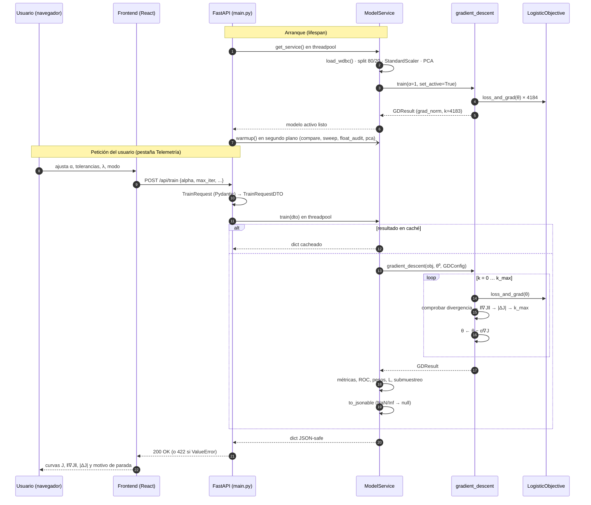
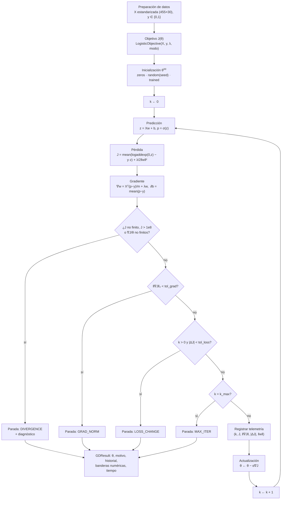

# Flujo de datos

## 1. Flujo de ejecución (arranque y petición de entrenamiento)

*Fuente: [`docs/diagrams/execution_flow.mmd`](../diagrams/execution_flow.mmd).*

**Explicación.**

1. **Arranque.** El `lifespan` de FastAPI crea el `ModelService` singleton, que carga los datos y entrena el modelo por defecto ($\alpha=1$; 4183 iteraciones). Después lanza `warmup()` en un *executor* para precalcular en segundo plano lo que piden las pestañas al abrirse, sin retrasar el arranque.
2. **Petición.** Pydantic valida el cuerpo y lo responde con 422 si está fuera de rango. El DTO pasa al servicio en un hilo. Si la misma configuración ya se calculó (y no promueve el modelo), se devuelve desde la caché.
3. **Cálculo.** El optimizador itera hasta un criterio de parada. El servicio añade métricas, la curva ROC, los pesos ordenados, $L$ y $\alpha/(2/L)$, y submuestrea el historial a `max_points`.
4. **Serialización.** `to_jsonable` convierte los tipos de NumPy a tipos nativos y los no finitos a `null`. La respuesta es siempre JSON estándar.

## 2. Proceso de entrenamiento

*Fuente: [`docs/diagrams/training_pipeline.mmd`](../diagrams/training_pipeline.mmd).*

## 3. Transformaciones de los datos

| Paso | Entrada | Salida | Dónde |
|---|---|---|---|
| Carga | `load_breast_cancer()` | `X` (569×30), `target` | `loader.load_wdbc` |
| Etiquetas | `target` (0 = maligno) | `y = 1 − target` (1 = maligno) | ídem |
| Partición | `X, y, idx` | train 455 / test 114, estratificado | ídem |
| Escalado | `X_train_raw` | `X_train` con media 0 y desv. 1; `X_test` con los mismos parámetros | ídem |
| PCA | `X_train` estandarizada | `pca_train`, `pca_test` (2D, solo para gráficos) | ídem |
| Logits | `X`, `θ` | `z = X w + b` | `LogisticObjective.logits` |
| Probabilidades | `z` | `p = σ(z)` | `sigmoid` |
| Predicción en tiempo real | 30 valores crudos | `standardize` → `w·x̃` → `z` → `p` → banda de riesgo | `ModelService.predict` |

## 4. Estado

| Estado | Ámbito | Ciclo de vida |
|---|---|---|
| `WDBCDataset` | proceso (`lru_cache`) | inmutable (`frozen=True`) |
| `ModelService` | proceso (singleton `get_service`) | se crea al arrancar |
| Modelo activo (`ActiveModel`) | proceso | se reemplaza con `set_active=true` si el entrenamiento no diverge |
| Caché de resultados | proceso | LRU de 64 entradas; la clave incluye la versión del modelo activo |
| `LogisticObjective` | por petición | se descarta tras responder |
