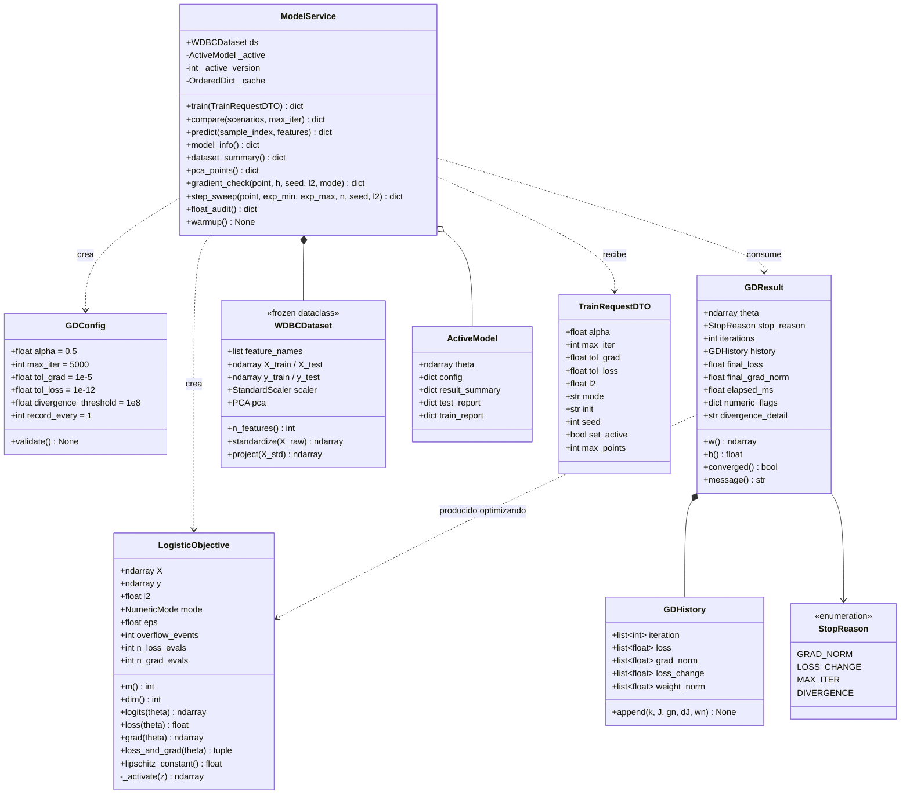
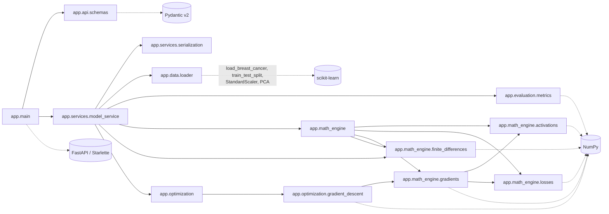

# Diseño de módulos

## Estructura del backend

```text
backend/app/
├── main.py                      # FastAPI: rutas, CORS, lifespan, threadpool
├── api/schemas.py               # Pydantic v2: TrainRequest, CompareRequest, PredictRequest, ...
├── data/loader.py               # WDBCDataset, load_wdbc(), translate_feature()
├── math_engine/
│   ├── __init__.py              # API pública del núcleo
│   ├── activations.py           # sigmoid, naive_sigmoid, log_sigmoid, count_exp_overflows
│   ├── losses.py                # bce_from_logits, binary_cross_entropy, naive_..., l2_penalty
│   ├── gradients.py             # LogisticObjective, logistic_gradient, logistic_loss, pack/unpack
│   └── finite_differences.py    # diferencias central/progresiva, gradient_check, step_size_sweep
├── optimization/gradient_descent.py  # GDConfig, GDHistory, GDResult, StopReason, gradient_descent
├── evaluation/metrics.py        # confusion, classification_report, roc_auc, roc_curve
└── services/
    ├── model_service.py         # ModelService (orquestación + estado) y get_service()
    └── serialization.py         # to_jsonable, downsample_indices
```

## Responsabilidades

| Módulo | Responsabilidad única | Entradas → salidas |
|---|---|---|
| `activations` | funciones de activación estables e ingenuas | `z` → `σ(z)`, `log σ(z)` |
| `losses` | pérdidas BCE en tres formulaciones + L2 | `(y, z o p)` → escalar |
| `gradients` | objetivo $J(\boldsymbol\theta)$ y su gradiente analítico; constante $L$ | `θ` → `J`, `∇J` |
| `finite_differences` | derivación numérica y auditoría del gradiente | `(f, θ, h)` → gradiente aproximado, errores |
| `gradient_descent` | iteración, criterios de parada, telemetría | `(objetivo, θ⁰, config)` → `GDResult` |
| `metrics` | evaluación del clasificador | `(y, p)` → métricas |
| `loader` | datos y preprocesamiento | — → `WDBCDataset` |
| `model_service` | componer lo anterior para cada caso de uso de la API | DTO → dict JSON-safe |
| `serialization` | frontera NumPy → JSON | objetos de NumPy → tipos nativos |

## Interfaz entre el optimizador y el objetivo

`gradient_descent` solo necesita del objetivo `loss_and_grad(θ)`, los contadores `overflow_events`, `n_loss_evals` y `n_grad_evals`, y que `θ` sea un vector plano (de ahí `pack`/`unpack`). Gracias a ese empaquetado $\boldsymbol\theta=[\boldsymbol w;b]$, el mismo objetivo sirve al optimizador, a las diferencias finitas y al método de Newton de las pruebas.

## Diagrama UML de clases



*Fuente: [`docs/diagrams/class_diagram.mmd`](../diagrams/class_diagram.mmd).*

El núcleo es mayoritariamente **funcional**: funciones puras sobre arreglos. Las clases son *dataclasses* de configuración y resultado, más dos clases con comportamiento: `LogisticObjective`, que encapsula los datos y la formulación numérica, y `ModelService`, que encapsula el estado de la aplicación.

## Dependencias



*Fuente: [`docs/diagrams/module_dependencies.mmd`](../diagrams/module_dependencies.mmd).*

Las líneas punteadas son dependencias externas. Solo `app.data.loader` toca scikit-learn.
