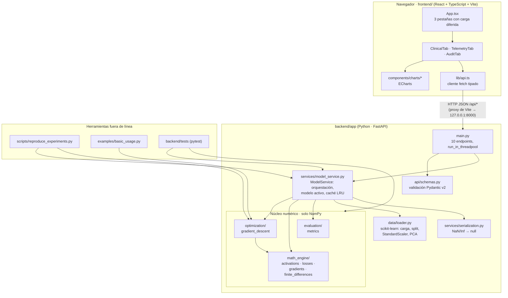

# Arquitectura del sistema

El sistema tiene dos procesos que se comunican por HTTP/JSON: una **API FastAPI** en Python, que contiene todo el cálculo, y una **aplicación de una sola página** en React, que solo visualiza. Fuera de línea, el mismo núcleo numérico se usa desde las pruebas, el script de experimentos y el ejemplo.

## Diagrama de componentes

*Fuente: [`docs/diagrams/system_architecture.mmd`](../diagrams/system_architecture.mmd).*

## Capas del backend

| Capa | Paquete | Responsabilidad | Depende de |
|---|---|---|---|
| Transporte | `app.main` | rutas HTTP, CORS, ciclo de vida, conversión de `ValueError` en HTTP 422, ejecución en *threadpool* | servicios, esquemas |
| Validación | `app.api.schemas` | rangos y tipos de las peticiones (Pydantic v2) | — |
| Servicio | `app.services` | orquestación, modelo activo, caché, construcción de respuestas JSON-safe | núcleo, datos |
| Núcleo numérico | `app.math_engine`, `app.optimization`, `app.evaluation` | matemáticas puras sobre arreglos NumPy, sin estado global ni E/S | **solo NumPy** |
| Datos | `app.data` | carga de WDBC, partición, estandarización, PCA | scikit-learn |

**Regla de dependencia.** Las capas solo importan hacia abajo, y el núcleo numérico no conoce ni FastAPI ni el servicio. `tests/test_architecture.py` hace cumplir que el núcleo no importe bibliotecas de *machine learning* (ver [decisiones de diseño](design_decisions.md)).

## Concurrencia

- Los *endpoints* son `async`, pero el cálculo NumPy bloquea la CPU: `_call` lo ejecuta con `starlette.concurrency.run_in_threadpool` para no bloquear el bucle de eventos.
- El modelo activo se reemplaza bajo un `threading.Lock` y la caché LRU tiene su propio candado.
- Cada petición crea su propio `LogisticObjective`, de modo que sus contadores no se comparten entre hilos.

## Frontend

Aplicación Vite + React 18 + TypeScript. Detalle en [frontend](../implementation/frontend.md). En desarrollo, Vite redirige `/api/*` a `http://127.0.0.1:8000`. En otro despliegue se usan `VITE_API_URL` en el cliente y `CORS_ORIGINS` en el servidor.

## Diagrama de dependencias entre módulos

Ver [diseño de módulos](module_design.md#dependencias).
