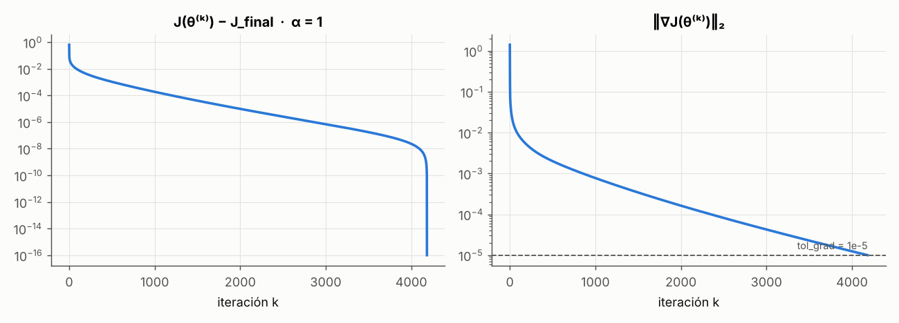
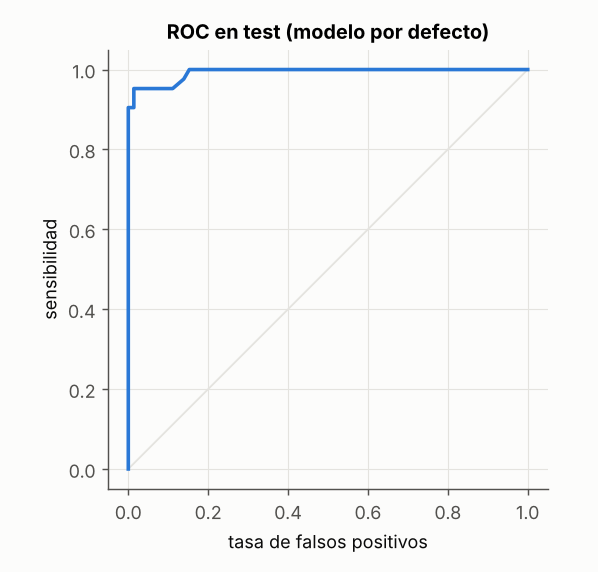
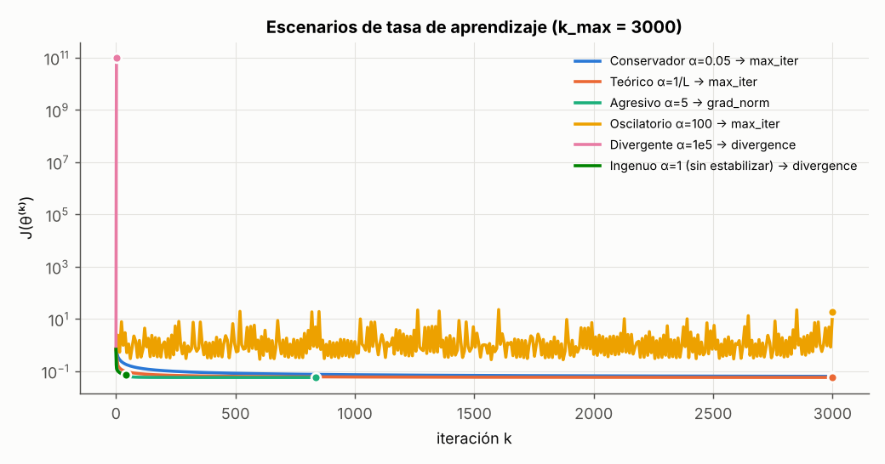
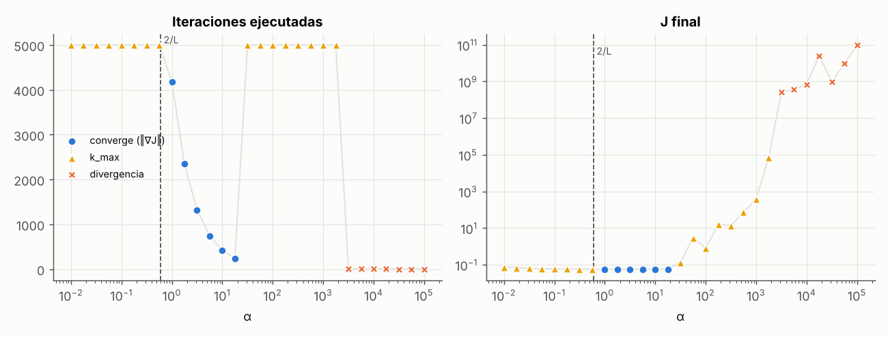
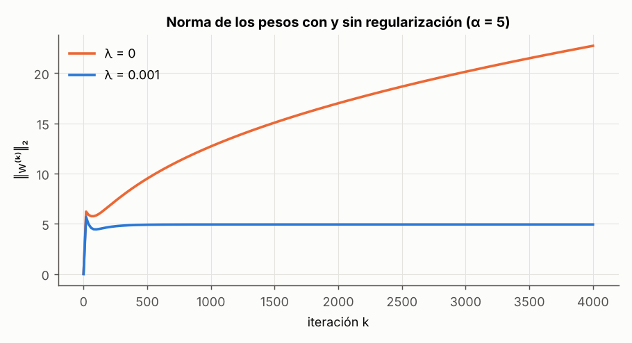
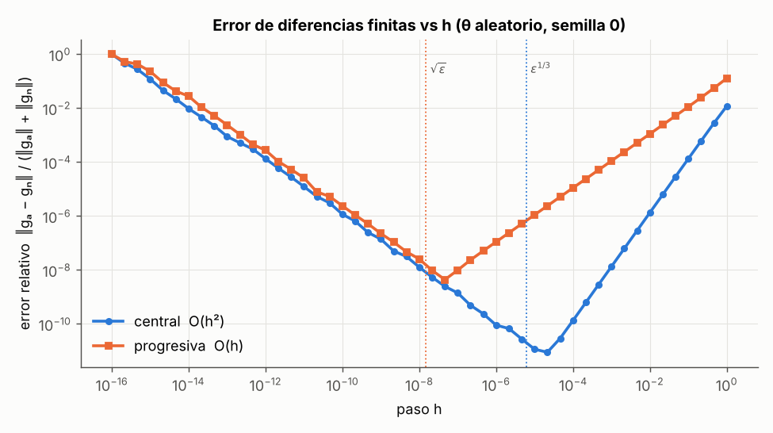
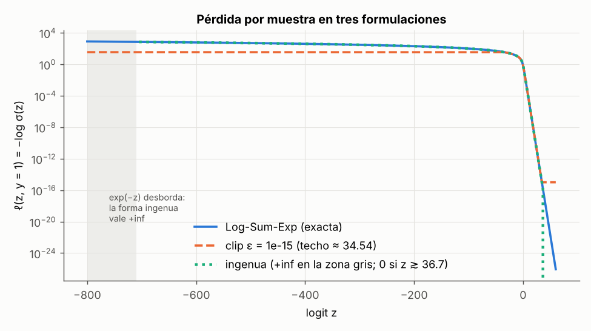

# Resultados

Todos los valores de esta página proceden de `results/metrics/*.json`, generados con `python scripts/reproduce_experiments.py` en el entorno registrado en `results/metrics/environment.json` (Python 3.13.18, NumPy 2.5.3, scikit-learn 1.9.1, Linux x86-64). Los tiempos de ejecución dependen de la máquina y solo se indican como referencia. La metodología está en [metodología experimental](experimental_methodology.md).

Las cifras de E1 y E2 coinciden con las que documentaba el README original del proyecto.

## E1 · Modelo por defecto

| Magnitud | Valor |
|---|---|
| $L$ / $2/L$ | $3.3455$ / $0.5978$ |
| Parada | `grad_norm` en **4183** iteraciones |
| $J$ final / $\lVert\nabla J\rVert$ final | $0.0579300$ / $1.0\times10^{-5}$ |
| Tiempo (referencial) | $\approx0.26$ s |

| Conjunto | Exactitud | Precisión | Sensibilidad | Especificidad | F1 | AUC | TP / TN / FP / FN |
|---|---|---|---|---|---|---|---|
| Entrenamiento (455) | 0.989 | 1.000 | 0.971 | 1.000 | 0.985 | 0.998 | 165 / 285 / 0 / 5 |
| **Prueba (114)** | **0.974** | 0.976 | **0.952** | **0.986** | 0.964 | **0.993** | 40 / 71 / 1 / 2 |

**Interpretación.** $J$ cae rápido en las primeras ~100 iteraciones y después converge linealmente: una recta en escala logarítmica. Es la firma de un problema fuertemente convexo pero mal condicionado. En prueba, el modelo comete 2 falsos negativos (malignos clasificados como benignos) y 1 falso positivo.

## E2 · Escenarios comparativos

$k_{\max}=3000$, $\boldsymbol\theta^{(0)}=\mathbf 0$, $\lambda=10^{-3}$.

| Escenario | $\alpha/(2/L)$ | Parada | Iteraciones | $J$ final | Exactitud en prueba |
|---|---|---|---|---|---|
| Conservador $\alpha=0.05$ | 0.08 | `max_iter` | 3000 | 0.0638 | 0.982 |
| Teórico $\alpha=1/L$ | 0.50 | `max_iter` | 3000 | 0.0582 | 0.974 |
| Agresivo $\alpha=5$ | 8.4 | **`grad_norm`** | **837** | 0.0579 | 0.974 |
| Oscilatorio $\alpha=100$ | 167 | `max_iter` | 3000 | 18.75 | 0.842 |
| Divergente $\alpha=10^5$ | $1.7\times10^5$ | **`divergence`** | 2 | $9.7\times10^{10}$ | 0.061 |
| Ingenuo $\alpha=1$ (modo `naive`) | 1.7 | **`divergence`** | 44 | `NaN` | 0.982 |

**Hallazgos.**

1. **$\alpha=5$, unas 8 veces la cota $2/L$, converge 5 veces más rápido que $\alpha=1$.** La cota es suficiente, no necesaria (ver E3).
2. **El escenario ingenuo "diverge" con parámetros perfectamente útiles.** En la iteración 44, algún logit supera $z\approx36.7$ ($\max\lvert z\rvert=62$ en el óptimo). $\sigma$ redondea a $1.0$ y la pérdida da `NaN` ($0\cdot\log0$), **sin un solo desbordamiento** (`exp_overflow_events = 0`). Sin embargo, $\boldsymbol\theta$ es finito, $\lVert\nabla J\rVert\approx0.016$ y clasifica el $98.2\,\%$ de la prueba. El fallo está en la **evaluación** de $J$, no en la iteración. El criterio de divergencia actúa como debe: un $J$ no finito no permite certificar nada.
3. **El conservador tiene mejor exactitud en prueba (98.2 %) que el óptimo (97.4 %).** Es la diferencia de **un** paciente de 114 y no debe interpretarse como evidencia de que detener antes generalice mejor (ver [amenazas a la validez](experimental_methodology.md#amenazas-a-la-validez)).

## E3 · Barrido de la tasa de aprendizaje

29 valores de $\alpha$ en $[10^{-2},10^5]$, $k_{\max}=5000$.

| Rango de $\alpha$ | Resultado |
|---|---|
| $0.01$ – $0.56$ ($\le2/L$) | `max_iter`: $J$ todavía entre $0.0736$ y $0.05793$ tras 5000 iteraciones |
| $1.0$ – $17.8$ | `grad_norm`: 4183 → 2349 → 1321 → 745 → 422 → **243** iteraciones |
| $31.6$ – $1778$ | `max_iter` con $J$ oscilante entre $0.14$ y $7.3\times10^4$ |
| $\ge3162$ | `divergence` en 2 a 7 iteraciones |

**Predicción teórica frente a observación.** En el óptimo, $\lambda_{\max}(\nabla^2J(\boldsymbol\theta^\star))=0.1132$, de modo que el análisis lineal local predice convergencia para $\alpha<2/0.1132=17.67$. La transición observada está entre $17.8$ (converge) y $31.6$ (no converge), en buen acuerdo. La cota global $2/L=0.598$ es unas **30 veces** más conservadora, porque $L$ supone $p_i(1-p_i)=\frac14$ para todos los pacientes, mientras que en el óptimo casi todos tienen $p_i$ cerca de 0 o 1 (ver [análisis local](../theory/optimization_algorithms.md#43-la-cota-2l-es-suficiente-no-necesaria-análisis-local)).

**Número de condición en el óptimo.** $\kappa=\lambda_{\max}/\lambda_{\min}=0.1132/0.0010005\approx113$. La convergencia lineal es lenta porque la dirección menos curvada solo la estabiliza el término $\lambda=10^{-3}$.

## E4 · Efecto de la regularización

$\alpha=5$, 4000 iteraciones (sin criterios de convergencia).

| $\lambda$ | $J$ final | $\lVert\nabla J\rVert$ final | $\lVert\boldsymbol w\rVert$ final | Exactitud en prueba |
|---|---|---|---|---|
| $0$ | 0.0195 (bajando) | $5.0\times10^{-4}$ | **22.7 (creciendo)** | 0.947 |
| $10^{-3}$ | 0.0579 | $3.4\times10^{-13}$ | 4.93 (estable) | 0.974 |

**Interpretación.** Sin regularización, $\lVert\boldsymbol w\rVert$ crece de forma sostenida mientras $J$ se acerca a $0$: es el comportamiento esperado cuando el estimador de máxima verosimilitud no existe por separación (cuasi)completa [Albert y Anderson, 1984]. El modelo se vuelve sobreconfiado y su exactitud en prueba baja 2.6 puntos (3 pacientes). Con $\lambda=10^{-3}$, el problema tiene un minimizador finito y el GD llega a él con $\lVert\nabla J\rVert\approx10^{-13}$.

## E5 · Auditoría del gradiente

| Punto | Error relativo | Veredicto |
|---|---|---|
| Aleatorio (semilla 0) | $1.15\times10^{-11}$ | excelente |
| $\mathbf 0$ | $8.9\times10^{-12}$ | excelente |
| Entrenado | $3.5\times10^{-7}$ | aceptable (el denominador $\lVert\boldsymbol g\rVert\approx10^{-5}$; ver [explicación](../theory/numerical_differentiation.md#4-chequeo-de-gradiente)) |

| Diferencia | $h$ óptimo empírico | Error mínimo | $h^\star$ ajustado | Regla teórica |
|---|---|---|---|---|
| Central | $2.15\times10^{-5}$ | $8.9\times10^{-12}$ | $1.63\times10^{-5}$ | $\varepsilon^{1/3}=6.06\times10^{-6}$ |
| Progresiva | $4.64\times10^{-8}$ | $4.4\times10^{-9}$ | $4.63\times10^{-8}$ | $\sqrt\varepsilon=1.49\times10^{-8}$ |

## E6 · Laboratorio de punto flotante

La tabla completa de valores especiales está en [aritmética de punto flotante](../theory/floating_point.md#4-tabla-de-valores-especiales-experimento-e6).

| Constante medida | Valor |
|---|---|
| Umbral de desbordamiento de `exp` | $709.7827$ |
| $z$ de saturación de $\sigma$ | $36.7368$ |
| Techo de la pérdida acotada | $34.5388$ |
| Umbral de subdesbordamiento | $-744.44$ |

## Resultados pendientes

No hay experimentos planificados sin ejecutar. Las extensiones posibles (validación cruzada, intervalos de confianza, comparación con otros optimizadores) están en [trabajo futuro](../introduction/scope_and_limitations.md#trabajo-futuro).
