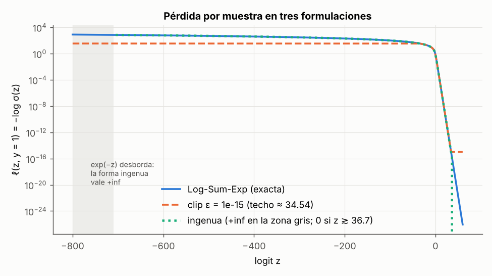

# Funciones de pérdida

El módulo `app/math_engine/losses.py` implementa la **entropía cruzada binaria (BCE)** en tres formulaciones que son algebraicamente equivalentes pero se comportan de forma muy distinta en aritmética de punto flotante. Coexisten a propósito: el objetivo académico del proyecto es **comparar** su estabilidad. En producción se usa la primera.

| Modo (`mode`) | Función | Fórmula evaluada | Estabilidad |
|---|---|---|---|
| `"logits"` (por defecto) | `bce_from_logits` | $\log(1+e^{z})-yz$ vía `np.logaddexp(0, z)` | exacta para todo $z$ finito |
| `"clipped"` | `binary_cross_entropy` | $-[y\log\hat p+(1-y)\log(1-\hat p)]$, $\hat p=\operatorname{clip}(p,\varepsilon,1-\varepsilon)$ | finita, pero acotada en $\approx34.54$ |
| `"naive"` | `naive_binary_cross_entropy` | $-[y\log p+(1-y)\log(1-p)]$ sin protección | `NaN`/`inf` desde $\lvert z\rvert\gtrsim36.7$ |

Más el término de regularización `l2_penalty` $=\frac\lambda2\lVert\boldsymbol w\rVert^2$.

---

## 1. Entropía cruzada binaria (forma de libro)

**Problema.** Medir cuánto se aleja una probabilidad predicha $p\in(0,1)$ de la etiqueta $y\in\{0,1\}$, de forma que el mínimo corresponda a la estimación de máxima verosimilitud (ver [probabilidad](probability_and_statistics.md#2-máxima-verosimilitud-y-entropía-cruzada)).

**Definición.**

```math
J_{\text{BCE}}=-\frac1m\sum_{i=1}^{m}\Big[y_i\log p_i+(1-y_i)\log(1-p_i)\Big].
```

**Variables.** $y_i$: etiqueta real; $p_i=\sigma(z_i)$: probabilidad predicha de malignidad.

**Intuición.** Solo uno de los dos términos está activo por muestra. Si $y_i=1$, la pérdida es $-\log p_i$: vale $0$ si $p_i=1$ y crece sin cota cuando $p_i\to0$. El castigo **logarítmico** hace que equivocarse con mucha seguridad cueste muchísimo más que equivocarse con duda.

| $p$ (si $y=1$) | $0.99$ | $0.9$ | $0.5$ | $0.1$ | $0.01$ | $10^{-10}$ |
|---|---|---|---|---|---|---|
| $-\log p$ | $0.010$ | $0.105$ | $0.693$ | $2.303$ | $4.605$ | $23.03$ |

**Por qué no el error cuadrático.** Con $(p-y)^2$ y $p=\sigma(z)$, el objetivo **no es convexo** en $\boldsymbol\theta$ y su gradiente $2(p-y)p(1-p)$ se anula cuando el modelo se equivoca con seguridad ($p\to0$ con $y=1$). La BCE da el gradiente limpio $p-y$ (ver [cálculo](calculus.md#2-la-pérdida-por-muestra-y-su-derivada-respecto-al-logit)).

## 2. Formulación Log-Sum-Exp (la que usa el motor)

**Derivación.** Se escriben los logaritmos de $\sigma$ en función del logit:

```math
\log\sigma(z)=\log\frac{e^{z}}{1+e^{z}}=z-\log(1+e^{z}),\qquad
\log\big(1-\sigma(z)\big)=\log\frac{1}{1+e^{z}}=-\log(1+e^{z}).
```

Al sustituir en la pérdida de una muestra:

```math
\ell(z,y)=-\Big[y\big(z-\log(1+e^{z})\big)+(1-y)\big(-\log(1+e^{z})\big)\Big]
=\log(1+e^{z})\big(y+1-y\big)-yz
=\boxed{\log(1+e^{z})-y\,z}.
```

**Por qué es estable.** $\log(1+e^{z})=\operatorname{logaddexp}(0,z)$, y NumPy la evalúa como $\max(0,z)+\log\!\big(1+e^{-\lvert z\rvert}\big)$ (con `log1p`). El argumento de `exp` es siempre $\le0$, así que **nunca desborda**, y para $z$ muy negativo el término $\log(1+e^{-|z|})$ se calcula con precisión relativa completa. En ningún momento se forma $p=\sigma(z)$, y desaparecen $\log 0$ y $0\cdot\log 0$.

**Ejemplo numérico.** $z=2$, $y=1$: $\log(1+e^{2})-2=\log(8.389056)-2=2.126928-2=0.126928$. Por la forma de libro: $-\log\sigma(2)=-\log(0.880797)=0.126928$. Coinciden.

**Caso extremo.** $z=-800$, $y=1$ (predicción totalmente errónea): la forma Log-Sum-Exp da exactamente $800$. La forma de libro da $-\log 0=+\infty$ y la acotada, $34.54$. Lo comprueba `test_bce_handles_saturation`.

**Código.**

```python
def bce_from_logits(y, z):
    return float(np.mean(np.logaddexp(0.0, z) - y * z))
```

**Coste:** $O(m)$ por evaluación (más el $O(md)$ de calcular $\boldsymbol z$).

## 3. Formulación acotada (clip)

**Idea.** Evitar $\log 0$ restringiendo $p$ al intervalo $[\varepsilon,1-\varepsilon]$ antes de tomar logaritmos.

**Efectos secundarios documentados y verificados:**

1. **Techo artificial.** La pérdida por muestra queda acotada en $-\log\varepsilon=34.5388$. Una muestra con $z=-800$ y $y=1$ aporta $34.54$ en lugar de $800$: se **subestima** el error de las muestras peor clasificadas, y su contribución al gradiente se anula (el `clip` tiene derivada cero fuera del intervalo).
2. **$1-\varepsilon$ no es representable.** En `float64`, $1-10^{-15}$ se redondea a $1-9.992\times10^{-16}$. La cota real para $y=0$ es $-\log(9.992\times10^{-16})\approx34.54$, no exactamente $-\log\varepsilon$. La prueba `test_bce_handles_saturation` incluye la aserción `1.0 - (1.0 - EPSILON) != EPSILON`.
3. **Suelo artificial.** Para $z\gtrsim34.5$ con $y=1$, la pérdida no baja de $\approx10^{-15}$, mientras que la exacta sigue decreciendo ($4.2\times10^{-18}$ en $z=40$).

## 4. Formulación ingenua (solo auditoría)

Evalúa la forma de libro sobre $p=\sigma_{\text{ingenua}}(z)=1/(1+e^{-z})$. Falla de dos maneras:

- **Saturación** (la más temprana): para $z>-\log(\varepsilon_{\text{mach}}/2)\approx36.74$, $1+e^{-z}$ redondea a $1$ y $p=1.0$ exacto. Si $y=1$, $(1-y)\log(1-p)=0\cdot\log0=0\cdot(-\infty)=\texttt{NaN}$, así que la media completa es `NaN`. **No hace falta ningún desbordamiento.**
- **Desbordamiento:** para $z<-709.78$, $e^{-z}=+\infty$, $p=0$ y $-\log p=+\infty$.

`test_naive_bce_produces_nan_from_zero_times_log_zero` reproduce el primer caso con $z=40$.

## 5. Término de regularización

```math
R(\boldsymbol w)=\frac\lambda2\lVert\boldsymbol w\rVert_2^2,\qquad\nabla R=\lambda\boldsymbol w .
```

El sesgo $b$ **no** se penaliza: penalizarlo sesgaría la probabilidad base hacia $0.5$ sin ningún beneficio de regularización. `l2_penalty` devuelve exactamente $0$ si $\lambda=0$ (evita un producto escalar innecesario).

## 6. Comparación visual



*Figura generada por `scripts/reproduce_experiments.py` (experimento E6). En la zona gris ($z<-709.78$) la forma ingenua vale $+\infty$ y no se dibuja. A la derecha ($z\gtrsim36.7$) cae a $0$ por saturación, mientras la acotada se queda en el suelo $\approx10^{-15}$.*

## 7. Limitaciones

- La pérdida mide calibración probabilística, no directamente el coste clínico de cada tipo de error.
- Con datos (cuasi)separables y $\lambda=0$, el ínfimo $0$ no se alcanza (ver [separación](probability_and_statistics.md#4-existencia-del-estimador-el-problema-de-la-separación)).
