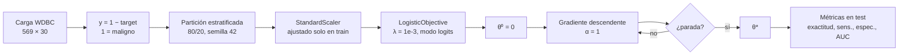

# Entrenamiento del modelo (proceso completo)

Este documento une las piezas teóricas en el orden en que se ejecutan cuando se entrena el modelo por defecto, ya sea al arrancar la API o con `examples/basic_usage.py`.

## 1. Etapas

| Etapa | Operación | Módulo |
|---|---|---|
| 1. Datos | `load_breast_cancer()` (copia de WDBC incluida en scikit-learn) | `data/loader.py` |
| 2. Etiquetas | $y=1-\text{target}$ | `data/loader.py` |
| 3. Partición | `train_test_split(test_size=0.2, random_state=42, stratify=y)` | `data/loader.py` |
| 4. Escalado | $\tilde x_j=(x_j-\mu_j)/s_j$ con estadísticos de entrenamiento | `data/loader.py` |
| 5. Objetivo | $J(\boldsymbol\theta)$, Log-Sum-Exp + L2 | `math_engine/gradients.py` |
| 6. Inicialización | $\boldsymbol\theta^{(0)}=\mathbf 0\Rightarrow J^{(0)}=\ln2$ | `services/model_service.py` |
| 7. Optimización | GD con $\alpha=1$, $k_{\max}=8000$, $\text{tol\_grad}=10^{-5}$, $\text{tol\_loss}=10^{-12}$ | `optimization/gradient_descent.py` |
| 8. Evaluación | $p=\sigma(X_{\text{test}}\boldsymbol w+b)$, umbral $0.5$ | `evaluation/metrics.py` |

## 2. Inicialización

- **`zeros` (por defecto):** como $J$ es convexa, el punto inicial no cambia el mínimo alcanzado. Partir de $\mathbf 0$ da $p_i=\frac12$ para todos y $J^{(0)}=\ln2\approx0.6931$ exacto (`test_converges_by_grad_norm`).
- **`random`:** $\boldsymbol\theta^{(0)}\sim\mathcal N(\mathbf 0,0.5^2I)$ con `numpy.random.default_rng(seed)`. Es reproducible.
- **`trained`:** continúa desde el modelo activo. Sirve para la auditoría en el óptimo.

## 3. Resultado del entrenamiento por defecto (E1)

| Magnitud | Valor |
|---|---|
| Motivo de parada | `grad_norm` ($\lVert\nabla J\rVert<10^{-5}$) |
| Iteraciones | 4183 |
| $J(\boldsymbol\theta^\star)$ | $0.0579300$ |
| Sesgo $b$ | $-0.0130$ |
| $\lVert\boldsymbol w\rVert_2$ | $\approx4.93$ |
| Exactitud entrenamiento / prueba | $98.9\,\%$ / $97.4\,\%$ |
| Matriz de confusión en prueba | $TP=40$, $TN=71$, $FP=1$, $FN=2$ |

Detalle y figuras en [resultados](../experiments/results.md).

## 4. Del modelo entrenado a una predicción

Para un paciente nuevo con medidas crudas $\boldsymbol x^{\text{raw}}$ (endpoint `POST /api/predict`):

1. Se estandariza con el **mismo** escalador: $\tilde{\boldsymbol x}=(\boldsymbol x^{\text{raw}}-\boldsymbol\mu)/\boldsymbol s$.
2. Se calcula la contribución de cada característica, $c_j=w_j\tilde x_j$, y el logit $z=\sum_jc_j+b$.
3. Se obtiene la probabilidad $p=\sigma(z)$ y la banda de riesgo: bajo si $p<0.2$, intermedio si $p<0.5$, alto si $p<0.8$ y muy alto en otro caso.

La descomposición $z=\sum_jc_j+b$ es **exacta** para un modelo lineal, y es lo que la interfaz muestra como "explicabilidad del logit" (verificado en `test_service_predict_paths`). Las bandas de riesgo son una convención de presentación del proyecto, **no** umbrales clínicos validados.

## 5. Reproducibilidad

- Todas las fuentes de aleatoriedad tienen semilla fija: partición con 42, inicialización aleatoria con `seed` y PCA con 42.
- El optimizador es determinista: dos ejecuciones con la misma configuración producen $\boldsymbol\theta$ **idénticos bit a bit** en la misma máquina (`test_gradient_descent_is_bitwise_reproducible`).
- Entre máquinas o versiones de NumPy/BLAS distintas pueden aparecer diferencias en los últimos bits (el orden de las sumas en BLAS puede variar). Las pruebas usan tolerancias, no igualdades exactas, salvo en la prueba de reproducibilidad dentro de una misma ejecución.
- `scripts/reproduce_experiments.py` registra las versiones de Python, NumPy y scikit-learn en `results/metrics/environment.json`.
