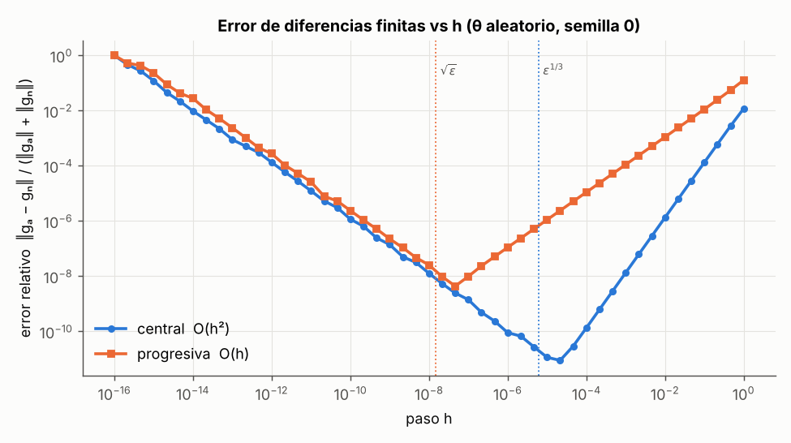

# Derivación numérica y verificación del gradiente

El gradiente analítico es la pieza más propensa a errores silenciosos: un signo cambiado o una transposición pueden producir un optimizador que "funciona" peor sin fallar. El proyecto lo **verifica** comparándolo con aproximaciones por diferencias finitas, y además estudia cómo depende la precisión de esas aproximaciones del paso $h$.

Implementación: `app/math_engine/finite_differences.py`.

## 1. Diferencia progresiva

**Definición.** Para cada componente $j$ de $\boldsymbol\theta\in\mathbb R^{n}$ ($n=31$):

```math
\frac{\partial J}{\partial\theta_j}\approx\frac{J(\boldsymbol\theta+h\boldsymbol e_j)-J(\boldsymbol\theta)}{h},
```

donde $\boldsymbol e_j$ es el $j$-ésimo vector canónico.

**Error de truncamiento** (de Taylor): $\dfrac h2\,\partial_j^2J(\xi)=O(h)$.

**Coste:** $n+1$ evaluaciones de $J$ (una compartida), es decir, $O(n\cdot md)$.

## 2. Diferencia central

**Definición.**

```math
\frac{\partial J}{\partial\theta_j}\approx\frac{J(\boldsymbol\theta+h\boldsymbol e_j)-J(\boldsymbol\theta-h\boldsymbol e_j)}{2h}.
```

**Derivación del error.** Restando las expansiones de Taylor en $\pm h$, los términos de orden par se cancelan:

```math
J(\boldsymbol\theta\pm h\boldsymbol e_j)=J\pm h\,\partial_jJ+\frac{h^2}{2}\partial_j^2J\pm\frac{h^3}{6}\partial_j^3J+O(h^4)
\;\Longrightarrow\;
\frac{J(+)-J(-)}{2h}=\partial_jJ+\frac{h^2}{6}\partial_j^3J+O(h^4).
```

**Error de truncamiento:** $O(h^2)$. **Coste:** $2n$ evaluaciones de $J$.

**Ejemplo exacto.** Para $f(t)=t^3$, $f'(t)=3t^2$ y $f'''=6$, la diferencia central da $3t^2+h^2$ **exactamente**. Con $t=1$ y $h=10^{-3}$, el error es $10^{-6}$. `test_finite_difference_orders_on_quadratic` comprueba este caso.

**Código.**

```python
def central_difference_gradient(f, theta, h=1e-5):
    theta = np.array(theta, dtype=np.float64, copy=True)
    grad = np.empty_like(theta)
    for j in range(theta.size):
        original = theta[j]
        theta[j] = original + h; f_plus = f(theta)
        theta[j] = original - h; f_minus = f(theta)
        theta[j] = original                     # restaura: sin efectos laterales
        grad[j] = (f_plus - f_minus) / (2.0 * h)
    return grad
```

El bucle sobre las componentes es inevitable, porque cada derivada parcial requiere evaluar $J$ en un punto distinto. Se trabaja sobre una copia para no modificar el $\boldsymbol\theta$ del llamador.

## 3. Error de redondeo y paso óptimo: la curva en V

En aritmética de punto flotante, cada evaluación $\operatorname{fl}(J)$ tiene un error relativo del orden de $\varepsilon_{\text{mach}}$. Al restar dos valores casi iguales y dividir por $h$, ese error se amplifica (**cancelación catastrófica**):

```math
E_{\text{central}}(h)\approx\underbrace{\frac{h^2}{6}\lvert J'''\rvert}_{\text{truncamiento}}+\underbrace{\frac{\varepsilon_{\text{mach}}\lvert J\rvert}{h}}_{\text{redondeo}},
\qquad
E_{\text{progresiva}}(h)\approx\frac h2\lvert J''\rvert+\frac{2\varepsilon_{\text{mach}}\lvert J\rvert}{h}.
```

Al minimizar $E(h)$ (derivando e igualando a cero):

```math
h^\star_{\text{central}}=\Big(\frac{3\varepsilon_{\text{mach}}\lvert J\rvert}{\lvert J'''\rvert}\Big)^{1/3}\sim\varepsilon_{\text{mach}}^{1/3}\approx6.06\times10^{-6},
\qquad
h^\star_{\text{progresiva}}=2\Big(\frac{\varepsilon_{\text{mach}}\lvert J\rvert}{\lvert J''\rvert}\Big)^{1/2}\sim\sqrt{\varepsilon_{\text{mach}}}\approx1.49\times10^{-8}.
```

En escala log-log, $E(h)$ forma una **V**. La rama izquierda tiene pendiente $-1$ (domina el redondeo) y la derecha, pendiente $+2$ en la central o $+1$ en la progresiva (domina el truncamiento).

**Resultados medidos** (E5, $\boldsymbol\theta$ aleatorio con semilla 0, 49 valores de $h$ en $[10^{-16},1]$):

| | $h$ con menor error | error mínimo | $h^\star$ del ajuste del modelo | $h^\star$ teórico |
|---|---|---|---|---|
| Central | $2.15\times10^{-5}$ | $8.9\times10^{-12}$ | $1.63\times10^{-5}$ | $6.06\times10^{-6}$ |
| Progresiva | $4.64\times10^{-8}$ | $4.4\times10^{-9}$ | $4.63\times10^{-8}$ | $1.49\times10^{-8}$ |

Los óptimos empíricos están dentro de un factor $\approx3$ de la regla teórica, que ignora las constantes $\lvert J\rvert/\lvert J'''\rvert$. La diferencia central alcanza una precisión unas **500 veces mejor**.



**Ajuste del modelo de error** (`_fit_v_model`). Se ajusta $E(h)\approx a\,h^p+c/h$ rama por rama, con estimadores robustos: $c=\operatorname{mediana\,geométrica}(E\cdot h)$ a la izquierda del mínimo y $a=\operatorname{mediana\,geométrica}(E/h^p)$ a la derecha. Solo se usan puntos con $E<10^{-2}$, porque para $h$ extremos el error relativo satura cerca de 1 por la forma del denominador. El óptimo del modelo es $h^\star=(c/(pa))^{1/(p+1)}$.

## 4. Chequeo de gradiente

**Métrica.** Error relativo simétrico entre el gradiente analítico $\boldsymbol g_a$ y el numérico $\boldsymbol g_n$:

```math
\text{err}=\frac{\lVert\boldsymbol g_a-\boldsymbol g_n\rVert_2}{\lVert\boldsymbol g_a\rVert_2+\lVert\boldsymbol g_n\rVert_2+10^{-15}}\in[0,1].
```

El $10^{-15}$ evita dividir entre cero cuando ambos gradientes son nulos (`test_relative_error_properties`). La métrica vale 1 si los gradientes son opuestos.

**Veredicto** (`classify_relative_error`):

| Error relativo | Veredicto | Lectura |
|---|---|---|
| $<10^{-7}$ | `excelente` | gradiente analítico correcto |
| $<10^{-5}$ | `aceptable` | correcto salvo ruido de redondeo o no suavidad local |
| $<10^{-3}$ | `sospechoso` | posible error o $h$ mal escogido |
| $\ge10^{-3}$ | `incorrecto` | el gradiente no coincide |
| no finito | `fallo` | $J$ produjo `NaN`/`Inf` |

Estos umbrales son convenciones prácticas habituales, no resultados teóricos. Con $h=10^{-5}$ y diferencia central, el error esperado ronda $10^{-11}$, cuatro órdenes por debajo del primer umbral.

**Resultados medidos** ($h=10^{-5}$, $\lambda=10^{-3}$):

| Punto $\boldsymbol\theta$ | $\lVert\boldsymbol g_a\rVert$ | error relativo | máx. error absoluto | veredicto |
|---|---|---|---|---|
| aleatorio (semilla 0) | $1.76$ | $1.15\times10^{-11}$ | $1.8\times10^{-11}$ | excelente |
| $\mathbf 0$ | $1.41$ | $8.9\times10^{-12}$ | $9.9\times10^{-12}$ | excelente |
| entrenado ($\boldsymbol\theta^\star$) | $1.0\times10^{-5}$ | $3.5\times10^{-7}$ | $2.7\times10^{-12}$ | **aceptable** |

**Por qué en el óptimo da "aceptable".** El **error absoluto** es igual o menor que en los otros puntos ($\sim10^{-12}$). Lo que cambia es el denominador: $\lVert\boldsymbol g\rVert\approx10^{-5}$, así que el mismo ruido de redondeo ($\varepsilon_{\text{mach}}J/h$) se vuelve grande **en términos relativos**. No indica ningún error del gradiente. Por eso la auditoría se hace por defecto en un $\boldsymbol\theta$ aleatorio.

**Prueba de sensibilidad.** `test_gradient_check_detects_wrong_gradient` inyecta un gradiente multiplicado por 2 y comprueba que el veredicto sea `incorrecto`: la verificación es capaz de detectar fallos.

## 5. Distinción importante

Las diferencias finitas **no** se usan para entrenar. El optimizador usa siempre el gradiente analítico, que es exacto y cuesta una sola evaluación de $O(md)$. La diferencia central necesita $2n=62$ evaluaciones de $J$ de ese mismo orden. Las diferencias finitas son solo una herramienta de **validación**, tanto en las pruebas como en la pestaña "Auditoría Matemática".
